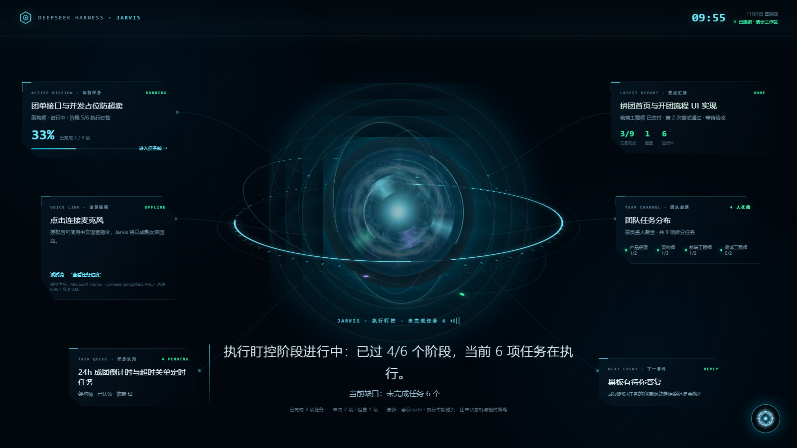

# luke-jarvis · 你的一句话，一家公司在替你干活  `v0.14.0`

> **别再一句一句地"问 AI"了——把需求丢给一家替你干活的数字公司。**
> 你说一句（哪怕模糊的）需求 → 它自动组建一支多角色 AI 团队，像真实公司一样澄清、拆解、分工、验证、返工——最后交给你**能逐条验收的成果**。

**它是什么**：一个 **DeepSeek Harness (DSH) 插件**——让 AI 从"你问一句、它答一段"变成"你给需求、它组织团队交付"。



---

## 🎯 核心能力

### 1. 需求澄清——没问清不开工
模糊需求由 CEO 带着领域专家主动问你（给谁用/怎样算成功），问清才动手，不瞎猜。

### 2. 自动组队——按需蒸馏"数字员工"
- 根据你的需求**现场确定领域和角色**（软件/金融/制造/医疗……领域无关）
- 每个员工带着**真实大佬的工作方式**干活，能力标注证据等级，产出对照指纹逐项验证
- 绩效不行就换，猎头按岗位画像找更强的人补位

### 3. 像公司一样交付——全程有闸
- **三产物硬闸**：需求规格 → 方案设计 → 测试验收单，全链可追溯，断链不许交付
- **测试独立验证**：开发说"写完了"不算，测试独立通过才算
- **阶段上报**：每完成一个阶段成果立刻上报审核，不符早纠正
- **变更评审**：需求中途变了走评审会，只动该动的

### 4. 可视化驾驶舱——Wings UI
打开 `http://<dsh>/jarvis-ui` 实时看进度：
- 中央 3D 全息核心，随鼠标视角联动；语音播报时光球心跳浮动
- 左右面板实时显示 jarvis 拆分的真实任务点（进行中/队列/交付/按人聚合）
- 团队协作页、进度六阶段、对话、语音设置全部数据化

### 5. 语音播报
浏览器 TTS 开箱即用，也可接入 OpenAI 兼容语音模型（服务地址/模型/音色/语速均可配）。

### 6. 项目记忆
角色卡、流程、经验沉淀在项目 `.jarvis/`，下次同类需求直接复用。

---

## 🚀 快速开始

```bash
# 1) 装包（二选一）
dsh plugin --profile web add luke-jarvis                 # 发布后
dsh plugin --profile web add file:C:/path/to/luke-jarvis # 本地开发

# 2) 一条命令收尾：技能落位 + bundle 登记
npx luke-jarvis setup --profile web

# 3) 重启 dsh web，然后自检
npx luke-jarvis doctor --profile web
```

然后对你的 AI 说：

```
/jarvis 我要做一个下沉市场的拼团电商小程序，2 人团 + 24h 成团，怎么设计？
```

**接下来发生的**：CEO 组队 → 团队开工 → 测试通过 → 交付验收。你只需要在"说需求"和"验收成果"两个时刻出现。

---

## ⚙️ 设置面板

安装后进入 **设置 → 内置插件 → luke-jarvis**，即可看到「路克贾维斯」配置卡片（保存后实时生效，无需重启）：

| 配置项 | 作用 | 默认值 |
|---|---|---|
| `ui` | 界面：`wings`（全息驾驶舱）/ `legacy`（经典版） | `wings` |
| `defaultWorkspace` | 解析不到工作区时的回退项目目录 | 空 |
| `workspaceMode` | 实例角色：`user`（上报+升级）/ `dev`（研发巡检+修复） | `user` |
| `voice.provider` | 语音来源：`browser` / `openai` | `browser` |
| `voice.baseUrl / model / voice / speed` | 语音模型地址 / 模型名 / 音色 / 语速 | api.openai.com / tts-1 / nova / 0.95 |
| `selfEvolution.*` | GitHub 自进化闭环：仓库 / Token / 上报确认门 / 审批门 / 升级渠道 | 见卡片 |

> 语音 API Key 在 Wings 界面的「语音设置」里填写（落盘本机 `~/.dsh/luke-jarvis/voice.json`，不进设置面板）。
> 升级插件后需重启 dsh web 一次（插件为启动期加载），再到内置插件页查看卡片。

---

## 🧪 质量

- 单测 **385/385** 全过（含核心引擎、工具闸、安装链路、设置卡片契约专项）
- 发布前 selfcheck 15 项自检，`setup + doctor` 全链路验证

---

> 💡 **luke-jarvis 不是一个工具，是一种"把 AI 当公司经营"的范式。** 你给它一句话，它给你一家数字公司——和可验收的成果。
