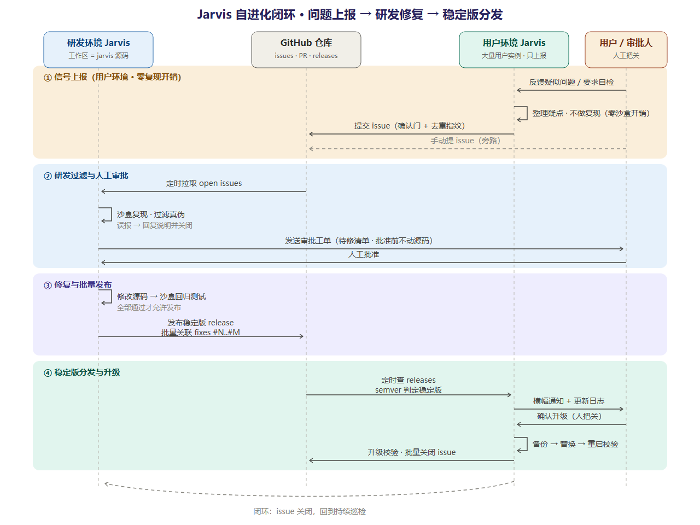

# GitHub 自进化闭环 · 设计文档

> 版本 v0.1（设计稿，UML 已定稿，待落地）
> 背景：Jarvis 要能"自己发现问题→上报→修复→分发升级"，形成与 GitHub 的完整自进化闭环。用户环境只当传感器（零沙盒开销），验证与修复责任全部在研发环境。

## 一、闭环总览

四个阶段：

| 阶段 | 执行方 | 动作 | 闸门 |
|---|---|---|---|
| ① 信号上报 | 用户环境 Jarvis | 自检/用户反馈 → 整理疑点（**不做沙盒复现**）→ 提 issue | 确认门 + 去重指纹 |
| ② 过滤与审批 | 研发环境 Jarvis | 定时拉取 open issues → 沙盒复现过滤真伪 → 误报自动回复关闭 → 真 bug 生成审批工单 | **人工批准，批准前不动源码** |
| ③ 修复与批量发布 | 研发环境 Jarvis | 修改源码 → 沙盒回归测试 → 全部通过后统一发稳定版 release | 测试全绿才允许发布 |
| ④ 分发与升级 | 用户环境 Jarvis + 人 | 定时查 releases（semver 判稳定版）→ 横幅通知 → 人确认升级 | **升级必须人把关** |

## 二、关键设计决策

1. **用户环境不做复现**：沙盒验证浪费用户资源；用户实例只负责"整理疑点 + 上报"，是否真 bug 由研发环境沙盒复现判定。
2. **审批在改代码之前**：Jarvis 不许先斩后奏——待修清单 → 审批工单 → 人工批准 → 才允许动源码。
3. **批量发版**：一批问题全部修复且测试通过后统一打一个稳定版，commit 关联 `fixes #N..#M`，升级后 issue 自动关闭。
4. **升级半自动**：自动发现（releases API + semver + prerelease 过滤）+ 通知，升级动作必须人确认——AI 替换自己运行的代码必须留人审。
5. **权限不对称即安全**：海量用户实例只往 issues 汇聚信号，没有任何用户实例能改动代码；只有工作区 = 源码仓的研发实例解锁修复链路（`workspaceMode: dev` 探测 git remote + package.json）。

## 三、落地增量（基于现有 superagent 架构，纯扩展零重构）

| 增量 | 说明 | 复用 |
|---|---|---|
| `jarvis_issue_sync` | 拉取 issues → 沙盒过滤 → 转审批工单（board `pending_approval` 状态） | board/events 状态层 |
| `jarvis_report_issue` | 疑点结构化 → 指纹去重 → 确认门 → POST issue | `.jarvis/effects.json` 存指纹 |
| `jarvis_release_check` | semver 对比 + prerelease 过滤 + 稳定版判定 | `intake.js` 已有 80% |
| `ports.github` | GitHub API 通道（Node fetch + PAT），测试注入 mock | Ports 模式现成 |
| `selfEvolution.*` 配置 | `reportMode`（confirm/auto）/ `approvalRequired`（默认 true）/ `releaseChannel`（stable）/ `githubToken` | Config schema 机制现成 |

出站写操作（提 issue / 发 PR）全部走 Engine 单写者 + commitEffects 队列，与其他 Effects 一致。

## 四、待定项

- **定时巡检**：DSH 插件无内置 cron。方案 A（推荐）：巡检约定化（晨会/巡检流程触发 `issue_sync`）；方案 B：server.mjs 桥接层定时器；方案 C：等 DSH 官方调度能力。
- **GitHub PAT**：需在 DSH 设置面板 `selfEvolution.githubToken` 配置；未配置时工具如实报"未配置，无法上报"，不静默降级。
- 研发侧发布建议走机器账号提 PR + 分支保护，merge 保留人工（或 auto-merge on green CI）。
